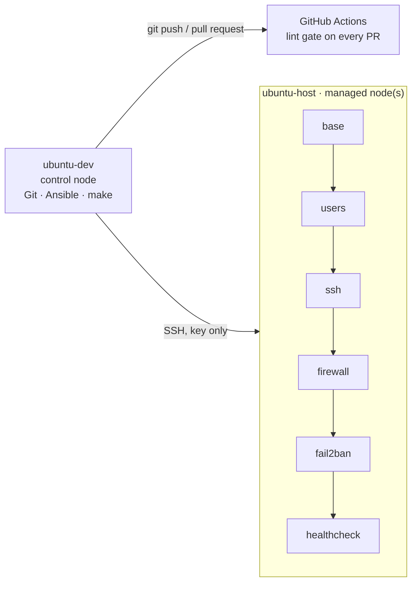

# linux-server-baseline


Ansible automation that turns a fresh Ubuntu server into a hardened, self-monitoring
baseline with one command, and proves it with an automated idempotency check.

## What it does

| Role | Result on the server | Safety feature |
|------|----------------------|----------------|
| `base` | Packages up to date, essential tools, timezone, automatic security updates | Idempotent apt cache handling |
| `users` | Admin users with SSH keys and passwordless sudo through a group | Sudoers file checked by `visudo` before install |
| `ssh` | No root login, no passwords, limited auth attempts | Config checked by `sshd -t` before install |
| `firewall` | ufw: deny all incoming except SSH and declared ports | SSH allowed before the firewall is enabled |
| `fail2ban` | Bans IPs after repeated failed logins, enforced via ufw | Bans expire automatically |
| `healthcheck` | Disk, memory, load and service checks every 5 minutes, with log rotation | Monitoring exit codes surface in `systemctl --failed` |

## Architecture



Roles run in this order on purpose: admin users and keys exist before passwords are
disabled, and SSH is allowed before the firewall turns on.

## Design principles

- **Everything in code.** No manual changes on the server; drift is corrected by re-running the playbook. People who cause drift are given a stern talking to!
- **Idempotent.** A second run reports `changed=0`, checked automatically by `make verify`.
- **Safe by default.** Risky config files are validated before they are installed using pre-commit and gitleaks to catch any security issues.
- **Reviewed changes.** `main` is protected; every change goes through a pull request and a required lint check. Only the braves developers commit directly to main.
- **Verified, not assumed.** Every role was tested by breaking it on purpose (see the incident log).

## Requirements

**Control node** (where you run Ansible): Linux with Python 3, `pipx`, `make` and `git`.

**Managed node** (the server/management server): Ubuntu, reachable over SSH, with a user that has sudo rights. Update the [ansible.cfg](ansible.cfg) file with the user and ssh key that Ansible will be using to connect to the managed servers.


## Quick start

**1. Clone the repo and install Ansible with its collections:**
```bash
   git clone git@github.com:goranmilic-source/linux-server-baseline.git
   cd linux-server-baseline
   pipx install --include-deps ansible
   ansible-galaxy collection install -r requirements.yml
```

**2. Create an SSH key for Ansible and copy it to the server(s):**
```bash
   ssh-keygen -t ed25519 -f ~/.ssh/ansible_ed25519 -C "ansible@control"
   ssh-copy-id -i ~/.ssh/ansible_ed25519.pub <user>@<server(s)>
```
Update the ansible.cfg file to use the ansible admin's private key:
   ansible.cfg: private_key_file = ~/.ssh/ansible_ed25519


**3. Creating users, admin users, user-ssh keys, and admin group(s).**

**Option 1 - Manual user setup**

Users, groups, and keys can all be created manually as you see fit.
The files used for user and group creation/removal are:
* user_add.yml
* user_groups.yml
* user_remove.yml

The aforementioned files are located in: [users](roles/users/defaults/main)
If you are removing users, make sure you also remove them from the "user_add.yml" file.
Copy the user PUBLIC ssh keys to the [files](roles/users/files) folder.

**Option 2 - Automatic user setup.**

Add the usernames (one per line) to the [user_add.conf](user_add.conf) file.
The script /scripts/user_add.sh can be run with
```bash
   make user_add
```
The script will:
   * Create all users specified in the user_add.conf file.
   * Create a folder called ssh_secrets which stores the PRIVATE and PUBLIC keys (keep your private keys safe!)
   * Create SSH keys preceded with the user's name.
   * Create a user_add.yml file and replace the default one located in [main](roles/users/defaults/main) folder.
   * Copy the PUBLIC SSH keys to [files](roles/users/files) folder.


**4. Point the inventory at your server.**

Edit `inventory/hosts.yml`: set `ansible_host` to your server's name or IP, and `ansible_user` to your login user.
If, for some very good reason, you are not using DNS, edit your local /etc/hosts file and manually enter in your server's IP and name.
OR, just use the IP address in your inventory/hosts.yml file.


**5. Apply the baseline and verify it:**
```bash

   make deploy    # asks for your sudo password
   make verify    # applies twice; fails if the second run changes anything
```

## Make targets

| Command | What it does |
|---------|--------------|
| `make help` | List all targets |
| `make deploy` | Apply the full baseline |
| `make verify` | Apply twice and fail unless the second run reports `changed=0` |
| `make lint` | Run yamllint, ansible-lint (production profile) and shellcheck, the same as CI |
| `make user_add` | Optional - Creates users and groups specified in the user_add.conf |

## Configuration

Every setting is a variable in a role's `defaults/main.yml`. Examples:

| Variable | Default | Meaning |
|----------|---------|---------|
| `users_admins` | `opsadmin` | Admin users and their key files |
| `firewall_allowed_ports` | `[]` | Extra ports to open |
| `firewall_removed_ports` | `[]` | Ports to close explicitly |
| `fail2ban_bantime` | `10m` | How long a ban lasts |
| `healthcheck_schedule` | `*:0/5` | When the health check runs (every 5 minutes) |

Override a value for one run with `-e`, for example:
`ansible-playbook site.yml -K -e healthcheck_disk_warn=70`

## Check the result on the server

```bash
sudo sshd -T | grep -E '^(permitrootlogin|passwordauthentication) '
sudo ufw status verbose
sudo fail2ban-client status sshd
systemctl list-timers healthcheck.timer
tail -n 3 /var/log/healthcheck.log
```

## Reset

The lab target is a VMware VM. To start over, revert it to a clean snapshot taken
before the first run, then follow the quick start from step 2.

## Repository layout

```
.github/workflows/   CI lint gate
docs/decisions/      Architecture decision records
docs/troubleshooting.md   Incident log (real and staged incidents)
inventory/hosts.yml  Target servers
roles/               base, users, ssh, firewall, fail2ban, healthcheck
scripts/             verify-idempotency.sh, user_add.sh
ansible.cfg          Ansible settings for this project
Makefile             deploy, verify, lint, user_add
requirements.yml     Ansible collections needed
site.yml             Main playbook
```

## Decisions and incidents

- [Decision records](docs/decisions/): why the project is built the way it is
- [Incident log](docs/troubleshooting.md): problems hit while building it, and how they were solved

## Operational notes

- **sshd uses the first value it reads; fail2ban uses the last.** The SSH
  hardening drop-in is named `01-hardening.conf` so it is read before any
  distribution file (such as `50-cloud-init.conf`) that might re-enable passwords.
- **A fail2ban `reload` does not reliably apply a change of ban action.**
  The role's handler restarts the service; bans persist across restarts.
- **Removing an item from a list does not undo it.** Ports and users are
  closed or removed by declaring it (`firewall_removed_ports`, `state: absent`),
  never by deleting them from the list.
- **The firewall is never reset as part of a routine run.** A reset fails open
  if a later task errors; see [ADR 0002](docs/decisions/).
- **`--check` cannot fully preview this playbook on a fresh server.** Tasks
  that depend on users or units created earlier in the same run report
  errors in check mode only.

## License

MIT
