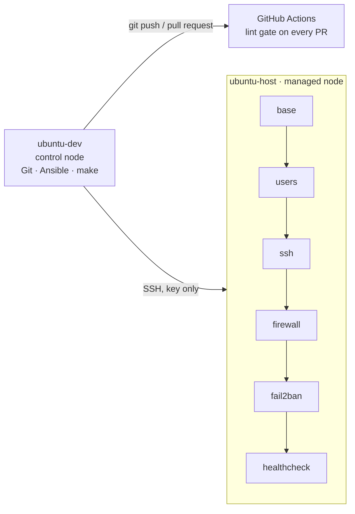

# linux-server-baseline


Ansible automation that turns a fresh Ubuntu server into a hardened, self-monitoring
baseline with one command, and proves it with an automated idempotency check.

## What it does

| Role | Result on the server | Safety feature |
|------|----------------------|----------------|
| `base` | Packages up to date, essential tools, timezone, automatic security updates | Idempotent apt cache handling |
| `users` | Admin users with SSH keys and passwordless sudo through a group | Sudoers file checked by `visudo` before install |
| `ssh` | No root login, no passwords, limited auth attempts | Config checked by `sshd -t` before install |
| `firewall` | ufw: deny all incoming except SSH and declared ports | SSH allowed before the firewall is enabled |
| `fail2ban` | Bans IPs after repeated failed logins, enforced via ufw | Bans expire automatically |
| `healthcheck` | Disk, memory, load and service checks every 5 minutes, with log rotation | Monitoring exit codes surface in `systemctl --failed` |

## Architecture



Roles run in this order on purpose: admin users and keys exist before passwords are
disabled, and SSH is allowed before the firewall turns on.

## Design principles

- **Everything in code.** No manual changes on the server; drift is corrected by re-running the playbook.
- **Idempotent.** A second run reports `changed=0`, checked automatically by `make verify`.
- **Safe by default.** Risky config files are validated before they are installed.
- **Reviewed changes.** `main` is protected; every change goes through a pull request and a required lint check.
- **Verified, not assumed.** Every role was tested by breaking it on purpose (see the incident log).

## Requirements

**Control node** (where you run Ansible): Linux with Python 3, `pipx`, `make` and `git`.

**Managed node** (the server/management server): Ubuntu, reachable over SSH, with a user that has sudo rights.

## Quick start

1. **Clone the repo and install Ansible with its collections:**
```bash
   git clone https://github.com/goranmilic/linux-server-baseline.git
   cd linux-server-baseline
   pipx install --include-deps ansible
   ansible-galaxy collection install -r requirements.yml
```
TEST THIS ----------------------------------------------------------------------------------------------------
2. **Create an SSH key for Ansible and copy it to the server(s):**
```bash
   ssh-keygen -t ed25519 -f ~/.ssh/ansible_ed25519 -C "ansible@control"
   ssh-copy-id -i ~/.ssh/ansible_ed25519.pub <user>@<server(s)>
```
Place the **PUBLIC** keys in the /roles/users/files folder. They will copied over when make deploy is run.


3. **Replace the admin public key with your own.** The key in the repo is the
   author's (cool guy, so I hear). Running the playbook unchanged would give the author access to your server (only if he finds you).
```bash
   cp ~/.ssh/ansible_ed25519.pub roles/users/files/opsadmin.pub
```
TEST THIS ----------------------------------------------------------------------------------------------------

4. **Point the inventory at your server.** Edit `inventory/hosts.yml`: set
   `ansible_host` to your server's name or IP, and `ansible_user` to your login user.
   If, for some very good reason, you are not using DNS, edit your local /etc/hosts file and manually enter in your server's IP and name.
   OR, just use the IP address in your inventory/hosts.yml file.


5. **Apply the baseline and verify it:**
```bash
   make deploy    # asks for your sudo password
   make verify    # applies twice; fails if the second run changes anything
```

## Make targets

| Command | What it does |
|---------|--------------|
| `make help` | List all targets |
| `make deploy` | Apply the full baseline |
| `make verify` | Apply twice and fail unless the second run reports `changed=0` |
| `make lint` | Run yamllint, ansible-lint (production profile) and shellcheck, the same as CI |

## Configuration

Every setting is a variable in a role's `defaults/main.yml`. Examples:

| Variable | Default | Meaning |
|----------|---------|---------|
| `users_admins` | `opsadmin` | Admin users and their key files |
| `firewall_allowed_ports` | `[]` | Extra ports to open |
| `firewall_removed_ports` | `[]` | Ports to close explicitly |
| `fail2ban_bantime` | `10m` | How long a ban lasts |
| `healthcheck_schedule` | `*:0/5` | When the health check runs |

Override a value for one run with `-e`, for example:
`ansible-playbook site.yml -K -e healthcheck_disk_warn=70`

## Check the result on the server

```bash
sudo sshd -T | grep -E '^(permitrootlogin|passwordauthentication) '
sudo ufw status verbose
sudo fail2ban-client status sshd
systemctl list-timers healthcheck.timer
tail -n 3 /var/log/healthcheck.log
```

## Reset

The lab target is a VMware VM. To start over, revert it to a clean snapshot taken
before the first run, then follow the quick start from step 2.

## Repository layout

```
.github/workflows/   CI lint gate
docs/decisions/      Architecture decision records
docs/troubleshooting.md   Incident log (real and staged incidents)
inventory/hosts.yml  Target servers
roles/               base, users, ssh, firewall, fail2ban, healthcheck
scripts/             verify-idempotency.sh
ansible.cfg          Ansible settings for this project
Makefile             deploy, verify, lint
requirements.yml     Ansible collections needed
site.yml             Main playbook
```

## Decisions and incidents

- [Decision records](docs/decisions/): why the project is built the way it is
- [Incident log](docs/troubleshooting.md): problems hit while building it, and how they were solved

## What I learned

<!-- Your own words. See Step 4. -->

## License

MIT
